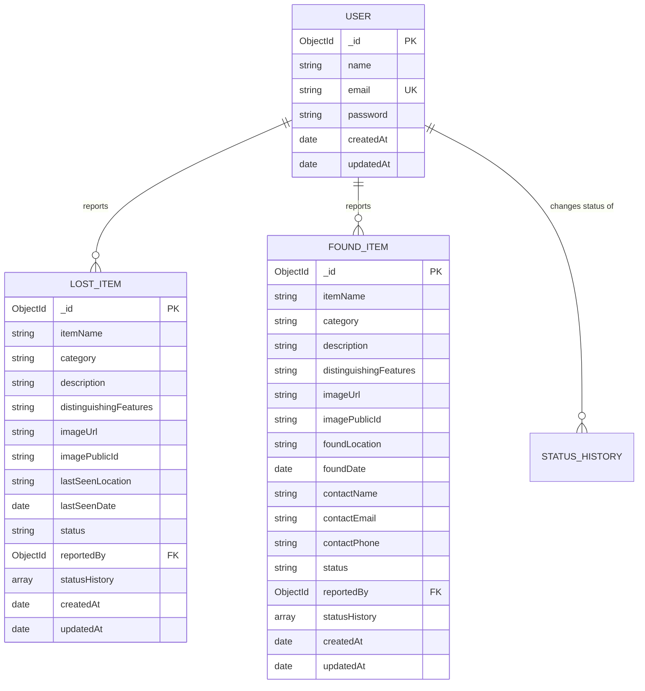

# CampusFind — Database Schema Documentation

This document describes the MongoDB database schemas, relationships, validation rules, status lifecycles, and indexes implemented in CampusFind using Mongoose ODM.

---

## 1. Overview of Collections

The database consists of three independent, highly decoupled collections:

1. **`users`** — Student and campus member accounts.
2. **`lostitems`** — Missing property reports submitted by students.
3. **`founditems`** — Found property reports submitted by students, including finder contact details.

> [!NOTE]
> Lost and Found reports are deliberately modeled in separate collections to preserve clean, domain-specific fields (e.g. `lastSeenLocation` vs `foundLocation`, `contactEmail`/`contactPhone` on found items) and prevent schema pollution.

---

## 2. Collections & Schemas

### A. User Schema (`models/User.js`)

Represents registered students on campus.

```javascript
{
  name: {
    type: String,
    required: [true, 'Name is required'],
    trim: true,
    minlength: 2,
    maxlength: 60
  },
  email: {
    type: String,
    required: [true, 'Email is required'],
    unique: true,
    lowercase: true,
    trim: true,
    match: /^[a-zA-Z0-9._%+-]+@[a-zA-Z0-9.-]+\.[a-zA-Z]{2,}$/
  },
  password: {
    type: String,
    required: [true, 'Password is required'],
    minlength: 8,
    select: false // Excluded from query results by default
  },
  createdAt: Date, // Timestamps option
  updatedAt: Date
}
```

#### Validation & Constraints:
- `name`: Required, 2 to 60 characters.
- `email`: Normalized to lowercase, trimmed, validated against email regex, and enforced unique via database index.
- `password`: Stored as a salted bcrypt hash. Flagged with `select: false` so that query operations like `find()` and `findById()` never leak the password hash to the client.

---

### B. LostItem Schema (`models/LostItem.js`)

Stores reports of missing belongings.

```javascript
{
  itemName: {
    type: String,
    required: [true, 'Item name is required'],
    trim: true,
    maxlength: 100
  },
  category: {
    type: String,
    required: [true, 'Category is required'],
    enum: [
      'Electronics',
      'ID Cards',
      'Bags',
      'Keys',
      'Books',
      'Clothing',
      'Accessories',
      'Other'
    ]
  },
  description: {
    type: String,
    required: [true, 'Description is required'],
    trim: true,
    maxlength: 2000
  },
  distinguishingFeatures: {
    type: String,
    trim: true,
    default: '',
    maxlength: 1000
  },
  imageUrl: {
    type: String,
    default: ''
  },
  imagePublicId: {
    type: String,
    default: ''
  },
  lastSeenLocation: {
    type: String,
    required: [true, 'Last seen location is required'],
    trim: true,
    maxlength: 150
  },
  lastSeenDate: {
    type: Date,
    required: [true, 'Date last seen is required']
  },
  status: {
    type: String,
    enum: ['open', 'matched', 'resolved'],
    default: 'open'
  },
  reportedBy: {
    type: mongoose.Schema.Types.ObjectId,
    ref: 'User',
    required: [true, 'Reported by user ID is required']
  },
  matchedFoundItemId: {
    type: mongoose.Schema.Types.ObjectId,
    ref: 'FoundItem',
    default: null
  },
  statusHistory: [
    {
      status: {
        type: String,
        enum: ['open', 'matched', 'resolved'],
        required: true
      },
      changedBy: {
        type: mongoose.Schema.Types.ObjectId,
        ref: 'User',
        required: true
      },
      changedAt: {
        type: Date,
        default: Date.now
      }
    }
  ],
  createdAt: Date,
  updatedAt: Date
}
```

#### Status Lifecycle:
```text
[ open ]  <======>  [ matched ]
    │                   │
    ▼                   ▼
      [ resolved ]
```
- `open`: The student is actively searching for the item.
- `matched`: A potential match has been reported or identified.
- `resolved`: The item has been safely recovered or the report is closed.

---

### C. FoundItem Schema (`models/FoundItem.js`)

Stores reports of belongings discovered across campus.

```javascript
{
  itemName: {
    type: String,
    required: [true, 'Item name is required'],
    trim: true,
    maxlength: 100
  },
  category: {
    type: String,
    required: [true, 'Category is required'],
    enum: [
      'Electronics',
      'ID Cards',
      'Bags',
      'Keys',
      'Books',
      'Clothing',
      'Accessories',
      'Other'
    ]
  },
  description: {
    type: String,
    required: [true, 'Description is required'],
    trim: true,
    maxlength: 2000
  },
  distinguishingFeatures: {
    type: String,
    trim: true,
    default: '',
    maxlength: 1000
  },
  imageUrl: {
    type: String,
    default: ''
  },
  imagePublicId: {
    type: String,
    default: ''
  },
  foundLocation: {
    type: String,
    required: [true, 'Found location is required'],
    trim: true,
    maxlength: 150
  },
  foundDate: {
    type: Date,
    required: [true, 'Date found is required']
  },
  contactName: {
    type: String,
    required: [true, 'Contact name is required'],
    trim: true,
    maxlength: 60
  },
  contactEmail: {
    type: String,
    trim: true,
    lowercase: true,
    default: ''
  },
  contactPhone: {
    type: String,
    trim: true,
    default: '',
    maxlength: 20
  },
  status: {
    type: String,
    enum: ['open', 'matched', 'returned'],
    default: 'open'
  },
  reportedBy: {
    type: mongoose.Schema.Types.ObjectId,
    ref: 'User',
    required: [true, 'Reported by user ID is required']
  },
  matchedLostItemId: {
    type: mongoose.Schema.Types.ObjectId,
    ref: 'LostItem',
    default: null
  },
  statusHistory: [
    {
      status: {
        type: String,
        enum: ['open', 'matched', 'returned'],
        required: true
      },
      changedBy: {
        type: mongoose.Schema.Types.ObjectId,
        ref: 'User',
        required: true
      },
      changedAt: {
        type: Date,
        default: Date.now
      }
    }
  ],
  createdAt: Date,
  updatedAt: Date
}
```

#### Status Lifecycle:
```text
[ open ]  <======>  [ matched ]
    │                   │
    ▼                   ▼
      [ returned ]
```
- `open`: The found item is currently held by the finder or campus front desk.
- `matched`: Potential owner has initiated contact.
- `returned`: Property verified and returned to its rightful student owner.

---

## 3. Database Indexes

To support rapid filtering, sorting, and text searching, the following indexes are registered:

### Users:
- `{ email: 1 }` (Unique): Enforces uniqueness at the database engine level and speeds up login lookups.

### Lost Items:
- `{ status: 1, category: 1, createdAt: -1 }`: Optimizes directory filtering and newest-first chronological sorting.
- `{ reportedBy: 1, createdAt: -1 }`: Accelerates student "My Reports" retrieval.
- `{ itemName: 'text', description: 'text', lastSeenLocation: 'text' }`: Text search index.

### Found Items:
- `{ status: 1, category: 1, createdAt: -1 }`: Optimizes found directory queries.
- `{ reportedBy: 1, createdAt: -1 }`: Optimizes user's submitted found items list.
- `{ itemName: 'text', description: 'text', foundLocation: 'text' }`: Text search index.

---

## 4. Entity Relationships


